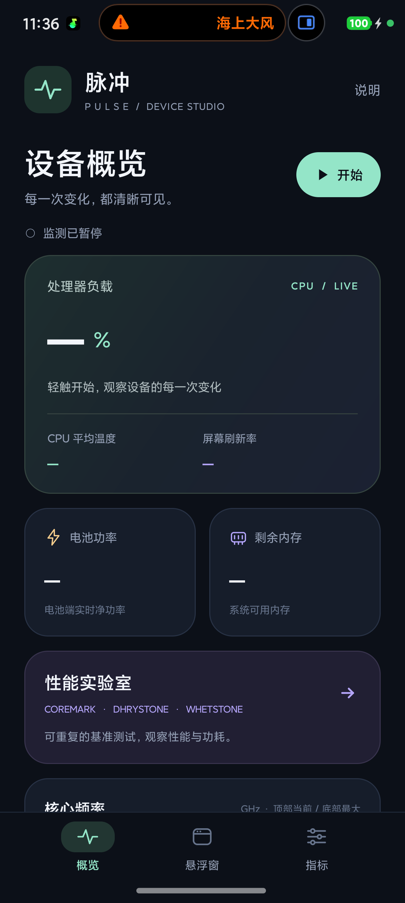
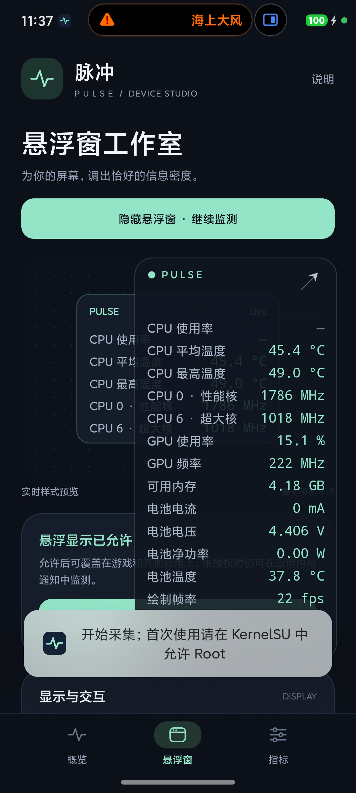
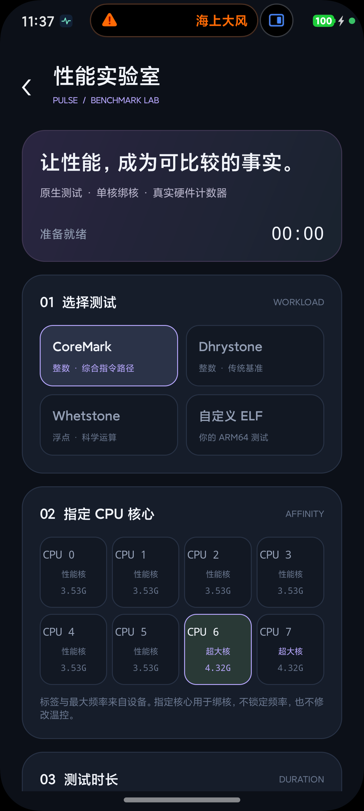

# Pulse

面向 Android 的本地性能仪表与原生基准测试工具。提供设备概览、可配置悬浮窗、常驻通知、硬件传感器读数与性能实验室。界面和业务代码独立开发；内置基准测试保留上游源码及来源说明。

> Local-first performance telemetry and native benchmarking for rooted Android devices.

## 下载

[下载 Pulse 1.0.0 APK](releases/Pulse-1.0.0.apk)

当前 APK 是面向 ARM64 测试设备的开发签名版本，已在小米 15 / Android 17 / KernelSU 上完成实机验证。SHA-256：

```text
F72AAA09E41937386899B64AC4E585533FC64402262A3DCBE9CF89DEF71EE813
```

安装更新时需要保持签名一致；正式发布前应改用单独保管的发行签名。

## 功能概览

- 可配置的实时悬浮窗与常驻通知，支持主题、字号、透明度、尺寸、拖动、折叠及触摸穿透。
- CPU 总体与逐核负载、频率、核心簇、温度，GPU、内存、电池、刷新率和可验证帧率来源。
- CoreMark、Dhrystone 2.1、Whetstone 1.2，输出动态每 MHz 估算、IPC、频率来源与原始 JSON。
- 通用与 Raw PMU 事件、内核事件源清单，以及用户自定义 ARM64 ELF 测试。
- 本地运行且不申请联网权限；缺失或不可信的读数明确显示不可用，不以演示数据补齐。

<table>
  <tr>
    <td></td>
    <td></td>
    <td></td>
  </tr>
  <tr>
    <td align="center">设备概览</td>
    <td align="center">实时悬浮窗</td>
    <td align="center">性能实验室</td>
  </tr>
</table>

当前适配设备为 **小米 15（dada），HyperOS OS4.0.0.19.XOCCNXM，Android 17，KernelSU Root**。项目使用 Android API 36 编译并设为目标版本，最低支持 API 26；这不表示已验证所有 Android 8.0 及以上设备。完整硬件读数需要在 KernelSU 中单独为「Pulse」授予超级用户权限。桌面与系统应用名称为 Pulse，内部界面保留中文标题「脉冲」。

应用不申请联网权限。监测只读取设备状态，不修改温控、CPU 频率、调度器、SELinux 或系统分区。

小米 15 实机验证中，一轮完整采样耗时约 81–137 ms，144 个指标中有 129 个可用；可用数量会随内核、硬件节点和当前状态变化。原生测试的 CRC、结果变量、超时、取消、PMU 与 Raw 参数边界记录保存在 [验证报告](docs/verification/) 中，这些记录用于功能验证，不作为受控环境下的性能排名。

## 开始使用

1. 安装 APK，从桌面打开「Pulse」。当前安装包采用开发调试签名。
2. 在 KernelSU 的超级用户列表中为「Pulse」授权。ADB 调试终端获得 Root，不代表应用已经获得 Root。
3. 打开「悬浮窗」，使用「管理悬浮权限」进入系统设置，允许显示在其他应用上方。
4. 点击「启动并显示悬浮窗」，或在「概览」点击「开始」。没有悬浮权限时仍可使用应用内监测。
5. 允许通知，以便从常驻通知返回应用或停止监测。若希望长期在后台运行，可在 HyperOS 应用设置中允许自启动，并将电量管理设为不限制。

运行中的悬浮窗可通过标题拖动位置，轻触标题折叠或展开，点击箭头进入应用。开启「触摸穿透」后，触摸交给下方应用；需要调整位置时，可回到应用关闭穿透。

## 悬浮窗与通知

在「指标」页搜索并勾选显示项目，可按日常精简、性能全览或全传感器预设选择，也可全部关闭后逐项添加。每个指标保留实际数据来源；未开放、无权限或无法可靠解释的项目显示「—」。

「悬浮窗」页可以配置：

- 字号 10–22 sp、背景不透明度 20–100%、宽度 150–320 dp。
- 薄荷、冰川、琥珀、月白主题，以及紧凑或舒展布局。
- 目标刷新间隔 0.5、1、2、3 秒。实际采样周期受硬件接口耗时影响，可查看采样耗时指标。
- 固定位置、触摸穿透、通知是否显示实时数值，以及开机自动监测。

监测服务运行期间保留基础前台通知。「通知显示实时数值」控制通知里的数值内容，不等于关闭前台通知。开机自动监测也受系统自启动与后台管理规则约束。

## 指标及其含义

| 类别 | 支持内容 | 需要正确理解的边界 |
| --- | --- | --- |
| CPU | 总体与逐核使用率、当前/最高频率、核心簇、平均/最高温度、具名温度传感器 | 频率来自 CPUFreq 节点，不等于硬件直接测出的每核执行时钟。小米 15 的性能核与超大核根据实际频率策略识别。 |
| 温度 | CPU、GPU、电池，以及系统公开的具名热传感器 | 本机 CPU 温度传感器与 8 个逻辑核的一一对应关系尚未证实，因此「每逻辑核温度」保留不可用，不把传感器编号冒充 CPU 核编号。 |
| GPU | 当前频率、使用率、温度及可用传感器 | 依赖 Qualcomm KGSL 与内核公开接口，其他监控工具同时读取可能影响区间计数。 |
| 内存 | 可用/已用内存、占用比例、交换空间 | 可用内存包含可回收缓存，交换空间不能解释为物理 RAM 占用。 |
| 电池 | 电量、温度、电流、电压、净功率，以及节点可用时的容量/循环次数 | 功率是电池端净功率的幅值，不是 CPU、SoC、充电器或整机输入功率。保留电流的驱动符号，不猜测厂商的正负方向。 |
| 画面 | 屏幕刷新率、可获得时的实际呈现帧率或绘制帧率 | Hz 与 FPS 分开显示。标为「绘制帧率」时，依据前台图层 frameReady 更新记录，**不等于已经呈现在屏幕上的 FPS**。 |

当前小米 15 的 SurfaceFlinger 实际呈现时间戳存在重复不更新的情况。因此，绘制帧率是明确标注的回退读数，不宣称已经验证真实呈现 FPS。静止画面的绘制帧率可以为 0。

详细接口、换算及验证记录见 [数据来源说明](docs/data-sources.md)。

## 性能实验室

从「概览」中的「性能实验室」进入。选择测试项目、CPU 核心与时长，然后开始运行；可从页面或运行通知中取消。

| 测试 | 输出 | 验证口径 |
| --- | --- | --- |
| CoreMark | CoreMark | 使用上游工作负载，执行校准、验证种子与性能测量；检查 CRC 和正式计时时长。 |
| Dhrystone 2.1 | DMIPS | 使用传统整数工作负载，并检查关键最终变量。 |
| Whetstone 1.2 | MWIPS | 使用双精度浮点工作负载；上游没有与 CoreMark 等价的 CRC 自检。 |
| 自定义 ARM64 ELF | 原程序结果、频率与可用计数器 | 不为任意程序编造标准成绩；执行与输出以原始结果为准。 |

可选择 10、30、60、120 秒。标准测试的时长是测量目标，校准、验证和完整迭代会增加总耗时；CoreMark 包含独立验证阶段，总时间通常超过所选时长的两倍。自定义程序的时长作为运行上限使用。

每次结果包含实际耗时、指定核心、成绩、有效性说明、频率和可用的性能计数器。绑核失败不会悄悄换核。不同测试使用不同单位，不能直接比较分数。

### 每 MHz 与 IPC

每 MHz 成绩优先采用用户态 CPU 周期与任务 CPU 时间计算的有效频率；必要时回退到每 100 ms 读取 CPUFreq 的采样均值。结果会保留实际归一化来源。

这是动态频率环境下的**估算值**，不是锁频测试，也不是满足全部披露要求的官方 CoreMark/MHz 提交成绩。温度、DVFS、后台工作负载、缓存状态及编译参数都会影响结果。

IPC 依据可用的指令与周期计数生成。硬件计数器可能被复用，不同事件的实际运行时间比例会影响比值解释；页面和 JSON 均保留该比例。无法取得必要计数时显示不可用。

### PMU 探测与原始事件

「探测 PMU 支持情况」会检查当前权限下通用硬件事件，并列出内核公开的事件源、设备类型、具名事件与格式编码。每个事件分别显示可用性、计数或不支持原因。

高级「原始 PMU 事件」默认留空：

- 每行填写一个十六进制事件码，可带 `0x` 前缀。
- 最多 8 个，每个 1–16 位十六进制，不接受重复代码。
- 事件含义与处理器型号相关，应依据对应处理器文档填写。应用不猜测厂商事件名称。
- 原始事件同时应用于探测与下一次测试；结果保留代码与实际读取状态。

Root 不保证所有 PMU 事件都能读取。支持范围取决于硬件、内核映射、调度与权限策略；通用缓存和停顿事件也不代表全部 Qualcomm 专用 PMU 已得到支持。

### 自定义程序

选择「自定义 ELF」，从系统文件选择器导入 ARM64 可执行程序。应用验证 ELF64、小端与 AArch64 机器类型，限制文件不超过 128 MB，并按 SHA-256 保存到应用私有目录。

参数输入框**每行一个普通参数**，空行忽略。参数按字面值传入程序，不把空格拆成多个参数，也不解析 Shell 命令。最多 64 行、总长度不超过 32 KB，单个参数不超过 2048 字符。

自定义程序以 Root 运行，应仅导入可信测试。文件头校验只确认架构格式，不代表程序逻辑或动态依赖已经验证。

### 历史与导出

正常返回的测试结果自动保存到应用私有目录的 `benchmarks/`，页面显示最近 30 次。点击历史条目可查看结果；原始 JSON 可复制或通过系统文件选择器导出。

JSON 保留成绩、验证说明、频率、PMU 可用性及原始程序输出等信息。卸载应用会清除私有目录内的历史与配置，需要保留的结果应先导出。

实现、上游来源、编译参数、验证方式及已知限制见 [原生基准测试说明](docs/BENCHMARKS.md)。

## 构建与签名

构建步骤、固定工具版本与验证命令见 [构建文档](docs/BUILD.md)。项目使用原生 Java / Android Views / Canvas 与 ARM64 原生测试组件，不依赖联网运行。

当前调试和本地 release 构建均使用**开发调试签名**，供本机开发测试；并非正式发布签名。覆盖更新并保留配置需要使用同一签名密钥。正式分发前应配置独立保管的发布密钥。

## 常见情况

- **应用能打开，但高级指标全是「—」**：确认 KernelSU 授权的是「Pulse」应用本身，再停止并重新开始监测。
- **只在应用中有数值，没有悬浮窗**：检查系统悬浮权限与应用内「启用悬浮窗」，再点击启动。
- **不能拖动悬浮窗**：检查「固定悬浮位置」与「触摸穿透」；拖动区域在标题上。
- **后台停止或开机后未恢复**：检查系统自启动、电量与后台限制。应用内开关不能替代系统授权。
- **部分温度、FPS 或 PMU 不可用**：先查看来源及原因。缺失读数不会被模拟数值补齐。
- **不同次测试成绩有变化**：先比较温度、频率、后台负载、测试时长与编译口径，保留原始 JSON 再作判断。

## 开源许可

Pulse 自主开发的源代码采用 [Apache License 2.0](LICENSE)。`app/src/main/cpp/vendor` 下的第三方基准源码不包含在 Pulse 的授权范围内，分别遵循其原始声明；精确版本、校验值与许可情况见 [基准测试说明](docs/BENCHMARKS.md)、[来源锁定文件](app/src/main/cpp/vendor-lock.json) 和 [NOTICE](NOTICE)。
