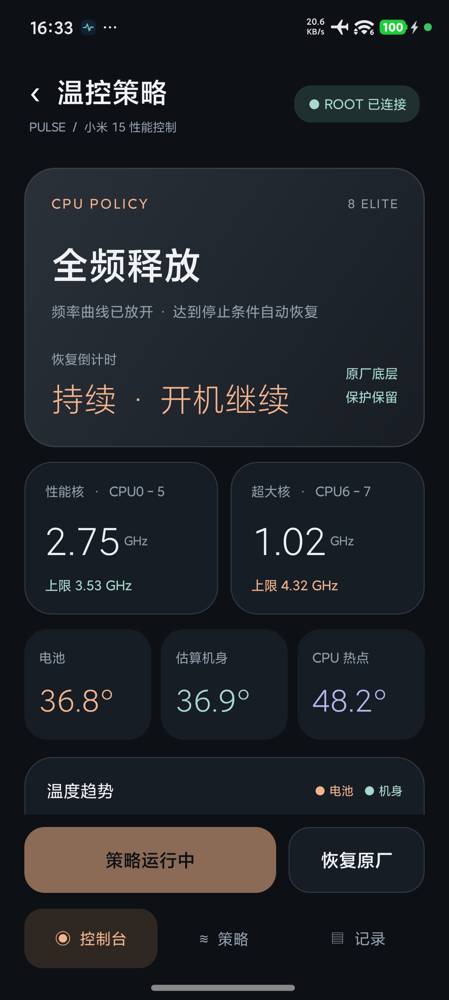
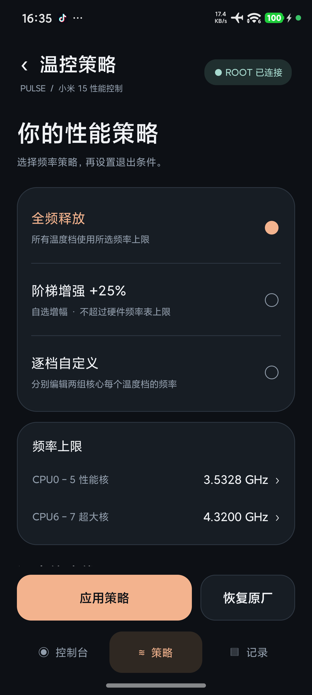

# Pulse 1.4.0 验证记录

日期：2026-10-19。基线为远端 `main` 的 `48a3601`（Pulse 1.3.0）。目标设备为 Xiaomi 15 / dada，Android 17，当前已适配的 HyperOS 温控程序，KernelSU Root。

## 安装包

- applicationId：`dev.pulse.monitor`，名称与桌面图标仍为 Pulse。
- versionName：`1.4.0`，versionCode：`5`。
- ARM64 APK：333,234 字节。
- SHA-256：`8cb084346a5558e098cb5f36a78aa76a1148b3dea6bda71263eb01d912e179a1`。
- 从手机重新拉取已安装 APK 后，SHA-256 与仓库发布文件一致。
- 仍只有原来的 `dev.pulse.monitor.MainActivity` 是桌面入口。温控 Activity 与服务不导出。
- 清单无 INTERNET 权限，原有权限及原功能组件保留。

## 构建与编码

`assembleDebug`、`assembleDebugAndroidTest`、`lintDebug` 均通过；Lint 无错误，保留原项目和平台 API 等警告。JDK 17、AGP 8.10.1、Gradle 8.11.1、API 36、NDK r29。

`ThermalCodecTest` 使用仅保存在本机工作区的原始材料，验证：原厂解码与重新编码逐字节一致；+25% 与全频配置和本次手机实验材料完全一致；0/10/25/50/100% 的增幅；自定义总上限；只改一组核心的逐档曲线；非法频率、增幅、自定义档位数及未知固件拒绝。

APK、源码和验证目录均不包含小米原始程序、原厂完整配置、密钥、应用数据备份或签名私钥。

## 温控真机集成

最终同一 APK 的完整仪器测试通过，原始结果见 [thermal-instrumentation.txt](thermal-instrumentation.txt)。

| 检查 | 结果 |
| --- | --- |
| UI 点击应用、加载后的全频明文哈希 | 通过，与先前实测全频配置一致 |
| 前台常驻通知及其「恢复原厂」操作 | 通过 |
| 停止后运行时长冻结 | 通过 |
| 真实一分钟倒计时退出 | 通过，停止原因为 TIMER |
| 主守护 SIGKILL 后独立守护恢复 | 通过，停止原因为 WATCHDOG_LOST |
| 同次开机调用启动钩子不重复应用 | 通过 |
| 模拟不同 boot-id：先恢复，再校验并继续 | 通过 |
| 单核心组自定义曲线应用与恢复 | 通过 |
| 真实频率/温度 CSV 导出 | 通过 |
| 结束后原厂明文 SHA、覆盖目录、启动钩子与残留进程 | 原厂 SHA 匹配，覆盖目录与启动脚本目录为空，无本工具运行进程 |

修复并回归了 Android mksh 中 `hash` 别名冲突，以及进程退出时 `/proc/PID/cmdline` 消失后管道误等输入的竞态。所有非交互 Root 命令关闭 stdin，进程身份检查采用明确文件参数的 `cat` 管道。

**没有实际重启整台手机。** 上述开机项是启动分发和恢复/继续路径的模拟验证；真实重启、HyperOS 自启动限制、长期持续运行、电池寿命与其他固件没有据此声称验证完成。系统底层保护与其他温控项保留。

## 原功能回归

新增功能位于独立包的温控子页；原来的采集、悬浮窗、小部件、性能实验室、PMU、自定义 ELF 及原生基准实现没有改动。原有主页面仅增加入口与更新说明，原三页导航保留。

- 原有监测集成套件（附 `overlay=true`、`widget=true`、`benchmark=probe`）：通过解析边界与两次真实采样，Root 可用，8 核，129/144 项可用；悬浮窗与小部件检查、性能实验室探测均成功后返回 PASS。
- 原 1.3 外观检查套件在此 APK 上通过：小部件配色、边框、0/55/100% 透明度、悬浮窗边框、重置与主题、兼容集合、设置控件、颜色输入应用/取消；用户设置保持不变。
- 本次未重新运行 CoreMark、Dhrystone、Whetstone 的完整计分矩阵；其实现与原生构建配置保留。这里没有把 PMU 探测当作三个基准的性能回归结果。

旧 APK 为 Mac 开发签名，与 Windows 构建签名不同。用户明确选择备份后重装；原 APK、CE/DE 数据先备份至设备和电脑并核验哈希，恢复原有设置，再重新授予 Root。监测配置恢复后与备份文件哈希一致。备份仅留本机工作目录，没有提交仓库。

## 实机界面

图中数据为当时真实采样；运行截图中的持续策略在验证结束时已恢复。

<table><tr>
<td></td>
<td></td>
</tr></table>
